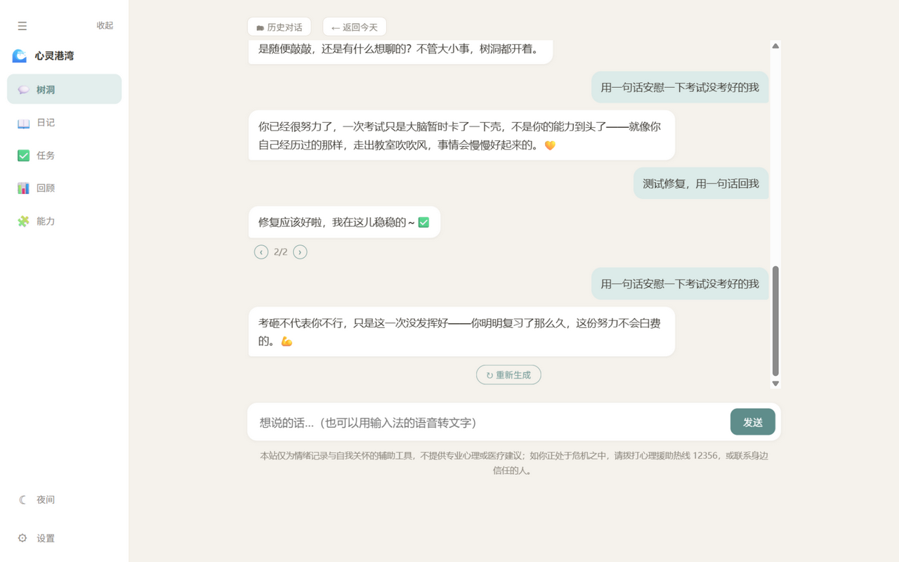
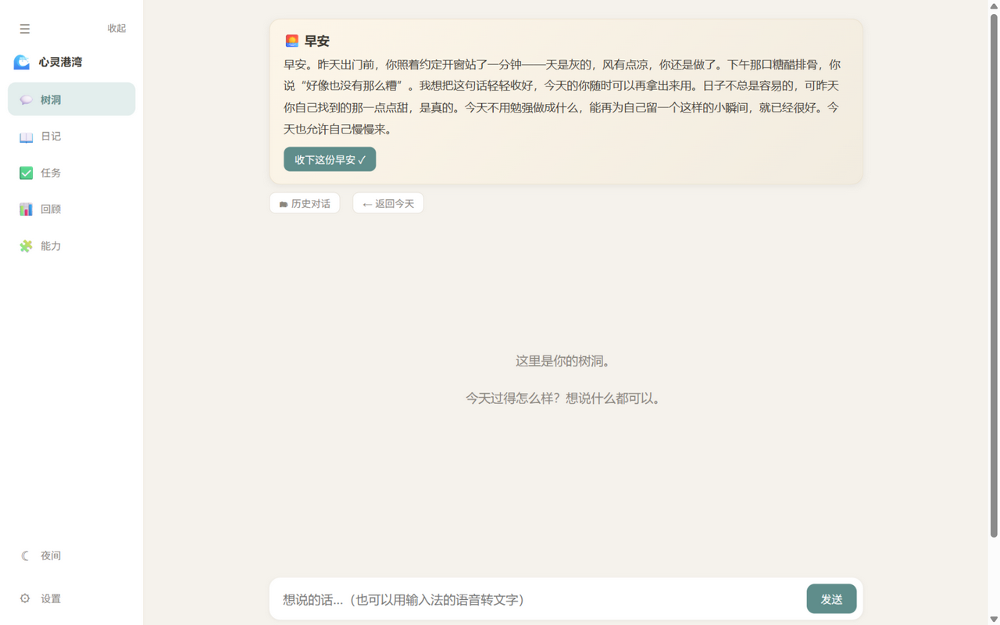
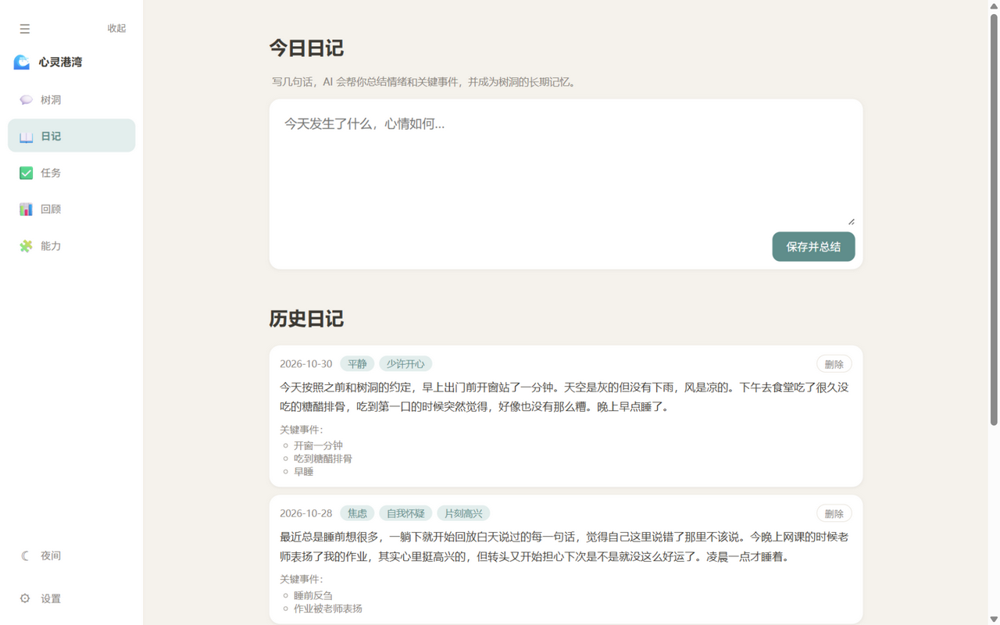
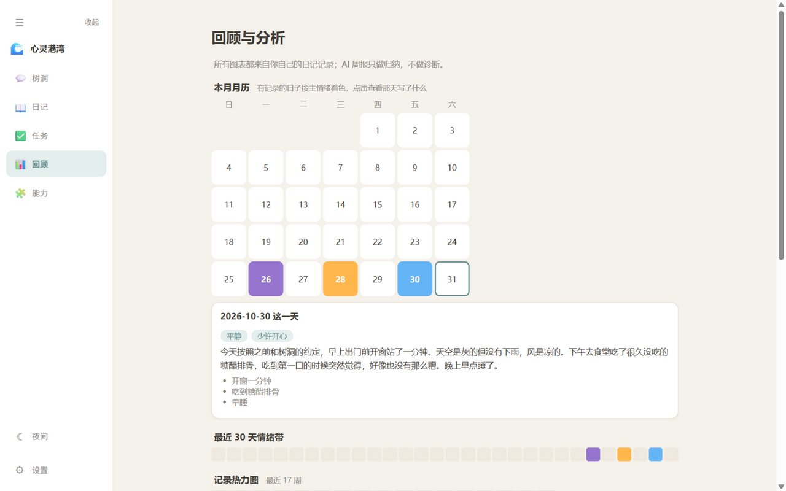
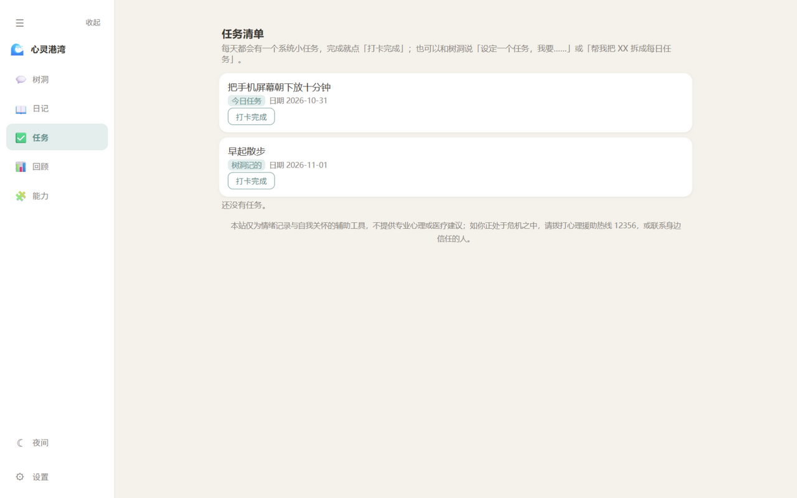
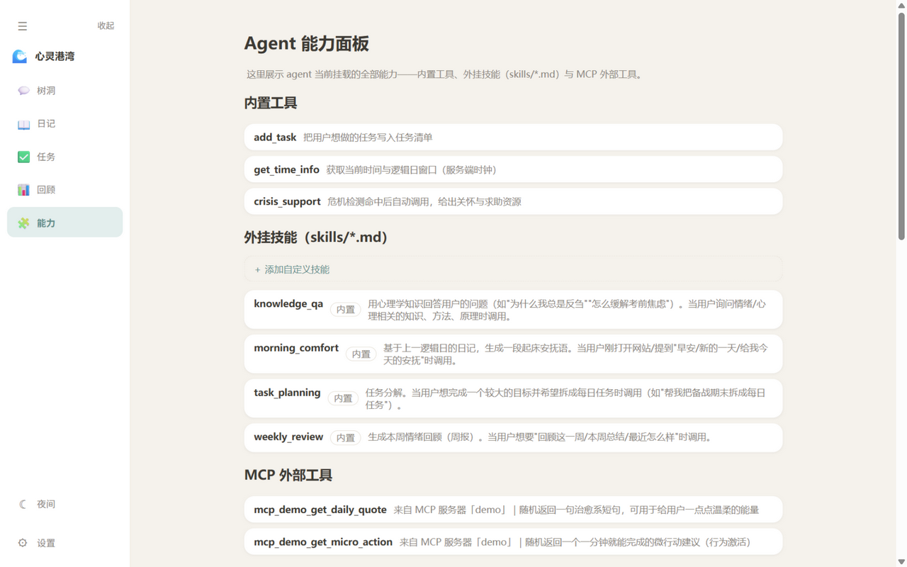

# 心灵港湾 🌊

一个**运行在你自己电脑上**的 AI 情绪日记与树洞小站。你可以每天写几句话、和树洞随便聊聊，它会记住你的事、学习心理学的视角，在你需要的时候给出温柔的回应——而**所有数据都只存在你自己的电脑里**。

> 灵感来自 [SillyTavern](https://github.com/SillyTavern/SillyTavern) 的本地架构：Node 服务跑在本机，浏览器只是界面。你的 API Key、日记、对话不出你的电脑（唯一的网络请求是你自己配置的模型 API）。

## ✨ 一分钟了解它能做什么

- **树洞对话**：像朋友一样陪你聊。它会翻你的记忆库（日记 + 历史对话小结）和心理学知识库来回应，能记住你前几天说过的话
- **重新生成**：对回应不满意？点 ↻ 重 roll，新旧版本都能保留，用 ‹ › 随时来回切换
- **情绪日记**：写几句话，AI 自动总结出情绪标签、关键事件和主题，并入库成为长期记忆
- **每日任务**：每天自动给你一个小到一分钟就能完成的小任务，打卡后 AI 会真诚地鼓励你
- **晨间安抚**：每天按你设定的"起床时间"生成早安卡片（夜班工作者可把逻辑日切分线设到下午）
- **回顾与分析**：月历、情绪带、热力图、统计条，以及每周一自动生成的 AI 周报
- **危机关怀**：当话语里出现求助信号时，自动给出关怀回应和求助热线卡片（宁可误报不可漏报）
- **自带 Agent 能力**：内置工具 + 外挂技能（可自己写）+ MCP 外部工具（可自己接），支持任务分解与编排
- **数据完全归你**：一键导出/导入全部数据（明文 JSON，不含 Key）

## 🖼 界面预览

| 树洞对话（含知识库问答与长期记忆） | 晨间安抚卡片 |
|---|---|
|  |  |

| 情绪日记（AI 自动总结） | 回顾与分析（月历可点开看当天） |
|---|---|
|  |  |

| 每日任务与 AI 鼓励 | Agent 能力面板 |
|---|---|
|  |  |

## 🚀 从零到用起来（三种方式任选）

### 第 0 步：准备两样东西

1. **Node.js 18 或更高版本**——去 [nodejs.org](https://nodejs.org/) 下载 LTS 版安装即可（`node -v` 能显示版本号就算装好了）
2. **一个大模型的 API Key**——本项目默认用[智谱开放平台](https://open.bigmodel.cn/)的 GLM 系列（注册后在"API Keys"页面创建，形如 `xxxxxxxx.xxxxxx`）。任何 OpenAI 兼容接口都行，在设置里填对应的地址和模型名即可

### 方式一：下载压缩包（不会用 Git 也能跑）

1. 打开仓库页面 → 绿色 **Code** 按钮 → **Download ZIP** → 解压到任意目录
2. **双击 `start.bat`**——第一次会自动安装依赖（需要等一两分钟），然后自动打开浏览器

### 方式二：Git 克隆

```bash
git clone https://github.com/11yunwu11/xinling-gangwan.git
cd xinling-gangwan
```

然后同样**双击 `start.bat`**。

### 方式三：命令行

```bash
npm install
npm start
```

### 首次配置（约 60 秒）

服务启动后浏览器会自动打开 `http://localhost:3000`，并弹出配置窗口：

1. **API Key**：粘贴你的 Key（它只保存到你电脑的 `config.json`，该文件已被排除在代码仓库外，永远不会上传）
2. **对话模型 / 接口地址**：默认是智谱的 `glm-5.3-flash`，换供应商就改这两项
3. **起床时间**：这是"逻辑日"的切分线。普通作息保持 `07:00`；夜班工作者可以设成自己入睡后的时间（比如 `16:00`），凌晨 3 点写的日记会算进"昨天"
4. 点**保存并开始**——服务会自动构建心理学知识库、连接 MCP 演示服务器，然后就能用了

之后每天使用都只需双击 `start.bat`。

## 🧭 功能使用指南

### 🕯 树洞对话

- 输入框里打字，**Enter 发送**（Shift+Enter 换行；中文输入法选词的回车不会误发）
- 回应是**流式**的，边生成边显示；中间如果 agent 调用了工具或技能，会有一行小字提示（如"📚 翻了翻知识库"）
- **重新生成**：每轮回应下方有「↻ 重新生成」按钮，不满意就 roll 一次；roll 出的新版本会保留旧版本，点回应下方的 **‹ 2/2 ›** 可以在所有版本间来回切换，选中的那一版就是"最终版"（后续对话与记忆沉淀都以它为准）
- **历史对话**：点「🗂 历史对话」可以按天翻看任何一天的记录（只读）；「← 返回今天」回到当前对话。刷新页面会自动载入今天的对话
- 每天凌晨/清晨（按你的起床时间），前一天的对话会被自动浓缩成一段小结存入记忆库——所以树洞**跨天也记得你们聊过什么**

### 📖 情绪日记

- 在「日记」页写几句今天的事和心情，点「保存并总结」
- AI 会总结出**情绪标签**（2~4 个）、**关键事件**（1~3 条）和**主题词**，显示在日记卡片上；正文永远原样保存
- 日记进入树洞的长期记忆库——之后再和树洞聊到相关的事，它会"记得"（比如"上次你说要开窗站一分钟，做了吗？"）
- 写错了可以删：卡片右上角有「删除」按钮，会同时从记忆库移除

### ✅ 每日任务

- 「任务」页每天自动出现一个随机小任务（来自 `task-pool.json`，可自行增删条目），比如"在窗户前看一分钟的天空"
- 做完点「打卡完成」，AI 会生成一句**真诚不夸张**的鼓励语
- 也可以在树洞对话里直接说"设定一个任务，我要……"让 agent 帮你记；说"帮我把 XX 拆成每日任务"可以一次分解写入多条

### 🌅 晨间安抚与"逻辑日"

- 每天到你的起床时间，服务会基于**前一日的日记**自动生成一段早安卡片；你打开页面时如果还没读过，就会展示
- 点「收下这份早安 ✓」表示已读；当天不会再打扰
- 夜班工作者的关键设定：把起床时间设为下午（如 `16:00`），那么凌晨 1 点仍然属于"前一天"，日记和对话都会归到正确的日子

### 📊 回顾与分析

- **本月月历**：有日记的日子按当天主要情绪着色，**点击某天**可以直接看那天的日记全文和任务完成情况
- **30 天情绪带 / 17 周热力图**：一眼看出情绪起伏和记录频率
- **情绪标签 / 高频主题统计**：你最常出现的情绪和话题
- **AI 本周回顾**：每周一早上自动生成（也可手动点按钮），只归纳你自己记录里的内容，并附上相关心理学知识参考——不做诊断

### 🧩 能力面板（进阶玩家区）

「能力」页展示 agent 当前挂载的全部能力，也允许你扩展它：

**添加自定义知识卡片**：点「＋ 添加自定义卡片」，写标题、标签和内容（比如"考前焦虑的应对"）。保存后自动向量化入库，之后和树洞聊到相关话题时会被检索引用。

**添加自定义技能**：点「＋ 添加自定义技能」，四个字段：

| 字段 | 说明 |
|---|---|
| 技能名 | 小写英文（如 `breathing`），注册为 `skill_breathing` |
| 何时调用 | 一句话描述，模型据此判断什么时候调用它 |
| 注入上下文 | `无` / `知识库检索` / `最近 7 天日记` / `上一逻辑日日记` |
| 提示词模板 | 技能的"剧本"，可用 `{{context}}` 注入所选上下文、`{{user_request}}` 注入用户消息 |

保存后**立即生效**，不需要重启。也可以直接把 `.md` 文件放进 `skills/` 目录（同名格式），同样即刻生效。

**MCP 外部工具**：仓库自带一个演示 MCP 服务器（`mcp-demo/`，提供治愈短句和微行动两个工具）。想接自己的服务器，在 ⚙ 设置里编辑 MCP JSON（详见下文配置说明），保存后自动重连。工具调用有 15 秒超时隔离，MCP 服务器挂起不会拖死对话。

**内置内容受保护**：内置的 16 张知识卡片和 5 个技能（尤其危机回应指引）不可删除——这是安全兜底；你自己添加的内容随时可增删。

### ⚙️ 设置与数据备份

- ⚙ 设置里可以随时改：API Key、对话模型、Embedding 独立接口（默认与对话模型同一服务，可以分开配便宜的）、起床时间、MCP 服务器
- **数据备份**：一键**导出全部数据**为明文 JSON（日记/对话/任务/小结/周报/自定义卡片与技能，不含 Key）；换电脑或重装后**导入**即可恢复，支持"合并（自动去重）"和"覆盖"两种模式
- **换 embedding 模型也不怕**：服务检测到模型变化会自动把所有向量重新计算一遍，记忆不会错乱

## ⚙️ 配置详解（config.json）

首次配置窗口覆盖了常用项；以下字段也可以直接编辑文件（改完重启服务生效）：

| 字段 | 说明 |
|---|---|
| `port` | 服务端口，默认 `3000` |
| `host` | 监听地址，默认 `0.0.0.0`（手机局域网访问需要）。只在本机用可改 `"127.0.0.1"` 更安全 |
| `wakeTime` | 起床时间 `HH:MM`，逻辑日切分线，默认 `07:00` |
| `llm.baseUrl` / `llm.model` / `llm.apiKey` | OpenAI 兼容对话接口（智谱/DeepSeek/本地 Ollama 等均可） |
| `embedding.baseUrl` / `embedding.apiKey` / `embedding.model` | 可选：Embedding 独立接口，未填的字段沿用对话模型配置 |
| `rag.topK` / `rag.threshold` | 检索返回条数（默认 3）与相似度门槛（默认 0.3） |
| `mcpServers` | MCP 服务器列表，也可在设置里用 JSON 编辑 |
| `crisisKeywords` / `hotlines` | 危机关键词表与求助资源卡片（**热线号码使用前请自行核实**） |

## 🏗 它是怎么工作的（架构一览）

```
浏览器（public/，零构建原生 HTML/JS）
   │  SSE 流式 + REST
   ▼
本地 Node 服务（server/）
   ├─ routes/        按领域拆分的接口（config/chat/comfort/chats/tasks/diary/kb/skills/review/abilities/backup）
   ├─ lib/agent.js   Agent 多步循环：决策 → 调工具 → 拿结果 → 继续 → 流式输出
   ├─ lib/rag.js     双池余弦检索：日记记忆池 + 知识卡片池，分源注入提示词
   ├─ lib/skills.js  技能系统：skills/*.md 声明式技能 → 注册为 agent 工具
   ├─ lib/mcp.js     MCP 客户端（stdio + Streamable HTTP），外接工具
   ├─ lib/scheduler  node-cron 按起床时间定时：晨间安抚 / 周报 / 聊天沉淀
   └─ lib/store.js   data/ 目录 JSON 文件读写（原子写）
   │
   └──▶ 你配置的模型 API（唯一的对外请求）
```

单条消息的旅程：你的话入库 → 向量化检索记忆与知识 → agent 决定直接回应还是调工具/技能 → 流式输出 → 回应入库。全程在你电脑上完成。

## ❓ 常见问题

**Q：模型接口返回 429"余额不足"？**
去你的模型供应商后台充值或换资源包。报错不会写进聊天记录，充值后点回应下方的「↻ 生成回应」直接重试即可。

**Q：双击 start.bat 报"node 不是内部或外部命令"？**
Node.js 没装或没加入 PATH，重新安装 LTS 版后重开命令行窗口。

**Q：端口 3000 被占用了？**
`config.json` 里加 `"port": 3001`（或任意空闲端口）。

**Q：手机怎么访问？**
手机连**同一个 WiFi**，浏览器打开 `http://你电脑的IP:3000`（电脑 IP 用 `ipconfig` 查看）。不用手机时建议在 config.json 设 `"host": "127.0.0.1"` 关闭局域网暴露。

**Q：我的数据存在哪？怎么备份？**
全部在项目目录的 `data/` 下（纯 JSON，可直接看）。定期用 ⚙ 设置里的"导出全部数据"存一份最稳妥。

**Q：想彻底重置？**
删掉 `data/` 目录和 `config.json`，重新走一遍首启配置即可（数据删了就没了，先导出备份）。

**Q：换了一个模型供应商要改什么？**
对话模型：设置里改接口地址 + 模型名 + Key。Embedding 若跟着换，服务会自动重算全部向量。

**Q：为什么危机关键词会误触发？**
这是刻意的安全设计（宁可误报不可漏报）：命中"想死/不想活"等词时会展示热线卡片。关键词表在 `config.json` 的 `crisisKeywords`，可自行调整。

## 🤝 适合谁用 & 免责声明

适合想**私密地**记录情绪、想要一个"记得住你的事"的倾听者、同时在乎数据主权的人。它不是心理医生：不诊断、不提供医疗建议（页面页脚常驻此免责声明）。若你正处于危机中，请拨打心理援助热线（如 12356）或联系身边信任的人。

## 📄 协议

待定（首次公开发布前补充）。
